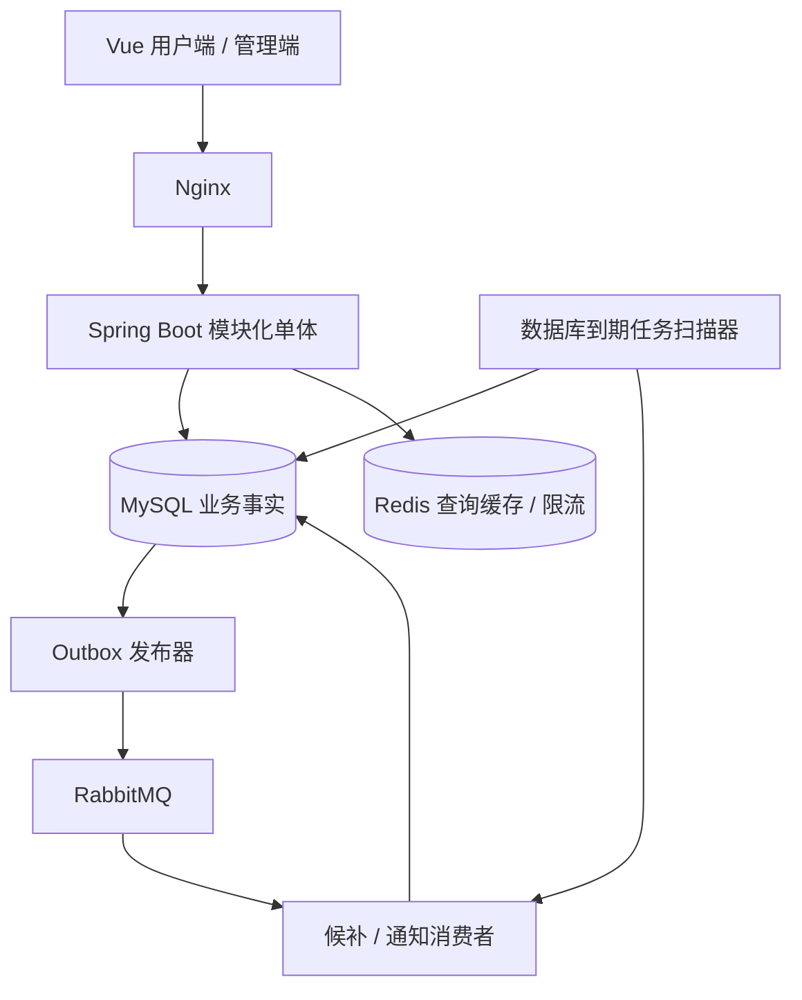
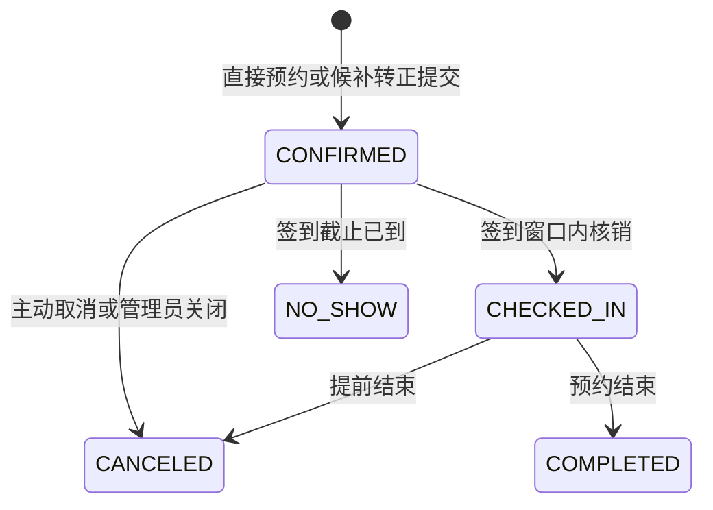

# FlashSlot 闪约：分时预约与候补调度系统开发设计文档

版本：1.1｜日期：2026-10-14｜状态：修订后的开发设计基线，尚未实现或压测

数据库后续协作更新：当前建表入口为 db/01 至 05，参见 db/README.md 及数据库协作设计记录。当前 14 表版本已去除设备分类、加入位置字段，并确认用户跨设备不能重叠；每日配额实现尚未确认，未创建独立配额表。本文及旧 15 表附件中涉及配额计数表的内容暂作为后续候选，不代表当前 SQL 已实施。完整应用仍未实现或压测。

本文将原始 `22.md` 的项目构想转化为可实施方案。原文中的性能数字、部署内存和可靠性结论不作为已验证事实。本文新增的业务规则是第一版默认决策，可以调整，但调整时必须同步修改状态机、数据约束和测试。

本轮按“可部署、用于 Java 后端实习求职、时间充裕并优先研究技术细节”的目标修订。稳定指业务决策和实施约束已明确，不表示未经实现就已证明运行稳定。旧版保存在 `archive/FlashSlot-开发设计文档-v1.0.md`；附属数据库设计见 `FlashSlot-数据库结构-v1.1.sql`。

V1 固定选择：设备预约、数据库事务确认、完全区间匹配、FIFO 候补、信用仅用于准入、单体部署。工程验证与性能实验按第 21 章推进，不同时引入多套预约写路径。

## 1. 项目目标与范围

### 1.1 首个落地场景

面向校园实验设备的分时预约。每台设备同一时间只能由一人占用，用户可预约连续时间段，设备满员时申请候补，取消或爽约后自动递补。

先完成这一场景，资源分类字段保留 `DEVICE / ROOM / COMPUTE` 扩展能力。第一版不支持同一资源同时多人使用；未来以具体设备实例建模，不能直接将“单份库存”改为容量计数而沿用现有正确性结论。

项目的可验收目标：

1. 多时间格预约全部成功或全部失败；同一设备同一格最多一个有效占用。
2. 相同请求重试不会生成重复订单、重复扣配额。
3. 取消后先处理规定范围内的候补，处理完成前不向直接预约开放被释放的格子。
4. 预约、签到、取消、超时判定发生竞争时，只有合法状态转换生效。
5. 消息重复、Redis 清空、应用进程重启不导致已提交预约丢失或重复分配。
6. 提供可以复现上述行为的页面、集成测试、故障实验和压测记录。

### 1.2 第一版交付范围

包含：账号登录、资源与开放日历、连续时段预约、个人订单、取消、签到、完全匹配候补、信用惩罚、管理页面、任务恢复、可观测性、隔离演示。

暂不包含：支付、短信、身份证实名验证、跨资源组合预约、任意区间撮合、周期预约、设备实际启动控制、多人容量、微服务、Redis 作为唯一库存事实来源。

“扫码签到”代表持有有效签到凭据，不能自动证明真实到场。第一版使用管理员展示的短时签到码；地理围栏、设备终端验证属于后续扩展。不宣称实现实名风控或彻底防黄牛。

### 1.3 技术基线

| 层次 | 默认选择 | 用途 |
| --- | --- | --- |
| 后端 | Java 21、Spring Boot 3.5.6 | 模块化单体，作为复现基线，不宣称最新版本 |
| 数据访问 | MyBatis-Plus 3.5.14 + 显式 SQL、Flyway | 使用 boot3 starter；Flyway 由 Boot BOM 管理 |
| 数据库 | MySQL 8.0.46、InnoDB | 订单、占用、配额、任务与事件事实 |
| Redis | Redis 7.4 | 排期缓存、限流；不维护候补镜像 |
| 消息 | RabbitMQ | 已持久化任务的唤醒、事件通知 |
| 前端 | Vue 3、TypeScript、Vite、Element Plus | 用户端与管理端 |
| API | springdoc-openapi webmvc-ui 2.8.13 | OpenAPI；V1 不同时引入 Knife4j |
| 验证 | JUnit、Testcontainers、JMeter 或 k6 | 真实数据库并发、故障与压力验证 |
| 部署 | Docker Compose、Nginx | 单机演示；非高可用部署 |
| 监控 | Actuator、Micrometer | 指标与健康探针；按需接 Prometheus |

现有 `cloud-test` 是微服务调用示例。本文仅作为独立项目设计写入 `docs/`，不修改现有业务代码。正式实现建议单独建立 FlashSlot 仓库。

工程基础已在 `../flashslot/` 落地：上述版本已实际构建并启动，使用私有临时 MySQL 验证 Flyway V1–V5 建立当前 14 张表、重复迁移、实体列映射、JSON/UTC 时间转换与 OpenAPI 生成。Jackson、Security、AMQP、Connector/J、Flyway 与测试库跟随 Boot BOM，Flyway 添加 flyway-mysql 模块。当前仅完成依赖、骨架与实体；认证、Compose、Redis/RabbitMQ 业务联调及完整 M0 尚未完成。运行方式见 `../flashslot/README.md`。

前端基线为 Node.js 22 LTS（至少 22.12）、Vue 3.5、TypeScript 5.9、Vite 7、Element Plus 2。M0 提交 package-lock.json，CI 使用 npm ci。部署使用 Redis 7.4、RabbitMQ 4.1、Nginx 1.28 系列，正式 Compose 必须锁定实际补丁 tag 和 digest，不使用 latest。镜像可用性和补丁兼容性在 M0 验证，不能把版本系列当作已锁定的发布产物。

## 2. 用户、页面与核心操作

### 2.1 角色

- USER：查看资源、预约、候补、取消自己的订单和候补、签到、查看自己的信用变化。
- ADMIN：仅用于管理，维护资源和开放日历、查看业务任务、审查故障、人工关闭他人预约、恢复任务、冻结账号；不能以本人身份创建预约、加入候补或签到。个人预约、候补与通知入口仅向 USER 开放，管理员保留账号资料和密码修改。
- DEMO：隔离演示环境中的测试账号；不能访问正式用户、订单或管理接口。

所有权限在后端执行。JWT 中的角色不是永久授权凭据；写操作查询账号的当前状态和当前权限。停用账号后的写请求应立即被拒绝。

### 2.2 页面清单

| 页面 | 主要内容 | 必须展示的异常行为 |
| --- | --- | --- |
| 登录 | 账号、密码、演示入口 | 凭据错误、限流、账号禁用 |
| 资源列表 | 分类、开放状态、未来可约日期 | 暂无资源、维护、加载失败 |
| 排期 | 30 分钟时间格、连续选段 | 已占用、交接中、已关闭、数据刷新 |
| 预约确认 | 日期、时段、配额、签到截止 | 冲突后重新选择或加入候补 |
| 我的订单 | 状态、签到、取消、处理进度 | 取消处理中、错过签到、权限错误 |
| 我的候补 | 排队状态、规则、转正订单 | 过期、取消、资格不满足 |
| 信用记录 | 事件、变更前后分值、限制截止 | 数据为空 |
| 管理端 | 日历、资源、失败任务、对账结果 | 修改冲突、正在使用、恢复失败 |
| 演示页 | A/B 账号、流程时间线、状态快照 | 演示环境复位中 |

前端不直接访问 Redis、数据库或 MQ 管理接口。可视化状态由后端脱敏读取。切换日期、资源和账号时防止旧请求覆盖新状态。

## 3. 业务规则：先固定边界

### 3.1 时间模型

- 业务时区：`Asia/Shanghai`；服务端时间权威，服务器配置时钟同步。
- `book_date` 为业务时区日期；绝对截止时间以 UTC `DATETIME(3)` 保存，接口返回带偏移的 ISO 8601。
- 固定格长 30 分钟，一天编号 `0..47`；`slot 18 = 09:00–09:30`。
- 区间统一左闭右开 `[start_slot, end_slot)`；例如 `[18,22)` 表示 09:00–11:00，共 4 格。
- 默认开放 08:00–22:00，即 `[16,44)`；开放日历可以配置关闭日，但第一版不改变格长。
- 仅允许连续格；同一请求 1–8 格，最多 4 小时。
- 可约日期：今天到今天 + 6 天，共 7 个业务日期。
- 最晚申请：预约开始前 30 分钟，含直接预约和候补入列；恰好到截止点禁止申请。
- 候补最晚转正：开始前 10 分钟；此时刻及之后不再自动转正。
- 每次事务在所需业务锁获取后捕获唯一 decisionTime，状态、退款和截止校验全部使用它。转正必须在候补用户和配额锁获取后取时间，不复用批次开始时间。提交后的网络传输时间不改变业务结果。

时间比较统一：直约/入列 decisionTime < startAt-30min；转正 decisionTime < startAt-10min；签到 startAt-10min <= decisionTime < startAt+15min；爽约 decisionTime >= checkInDeadline；完成 decisionTime >= endAt。将比较集中在领域时间策略，覆盖截止点、前 1ms、后 1ms。

资源未来开放日历必须先生成，再开放预约。缺少日历行返回 `CALENDAR_NOT_READY`，后台补齐，不能默认当作空闲资源。

### 3.2 配额与用户时间冲突

- 初始信用分 100，范围 0–100。
- 每用户每日默认最多 8 格，即 4 小时，单位始终使用“格”。
- 待签到和已签到订单占用其全部格数；签到完成不退还当天配额。
- 开始前取消返还全部格数；开始后取消仅返还尚未开始的格数。
- 爽约仅返还尚未开始的格数，已开始格计入已用配额。
- 完成订单仍占用当天配额；配额记录按历史保留，不依赖 Redis TTL。
- 同一用户不能在不同资源预约重叠时间；数据库用户时间格约束兜底。
- 候补不预扣配额，转正时重新检查配额和重叠预约。
- 同一用户、日期、资源、完整区间最多一个待处理候补；每日最多 3 个待处理候补。
- 新预约成功时，取消本人同资源同区间待处理候补；候补行必须在用户行之前锁定，修改可在订单创建后执行。

每张订单记录 `charged_slots`。退款时从当前值按状态规则一次性扣除，不根据重复消息重新计算。用户日配额等于当天订单 `charged_slots` 之和。

### 3.3 取消、签到与完成

- `CONFIRMED`：允许取消；开始前释放全部格，开始后只释放起始时刻大于等于当前判定时间的格。
- `CHECKED_IN`：允许提前结束，订单变为 `CANCELED`，只释放尚未开始格；保留实际签到和结束信息。
- `COMPLETED / CANCELED / NO_SHOW`：重复取消返回现有结果，不重复退款、释放或扣分。
- 签到窗口 `[开始前 10 分钟, 开始后 15 分钟)`；恰好到截止点禁止签到。
- 签到只允许订单本人，且账号仍有效；账号预约限制不阻止已有合法订单签到。
- 超时仅将截止已到且仍 `CONFIRMED` 的订单改为 `NO_SHOW`，扣 10 分。
- 到预约结束时，已签到订单转为 `COMPLETED`；未签到订单仍应通过超时规则进入 `NO_SHOW`。
- 自动任务迟到时，必须按实际时间判断可释放格。已开始格不能交给新用户。
- 已过去的占用行保留供审计，不用删除历史行表示完成。

所有订单写入口，包括取消、签到、管理员取消和定时任务，先在所需锁内归一化时间状态：CONFIRMED 且截止已到先执行 NO_SHOW；CHECKED_IN 且结束已到先执行 COMPLETED。归一化后的终态不再改变。09:00–11:00 已签到订单在 11:05 请求取消，即使扫描延迟，也必须返回 COMPLETED。

termination_reason 固定为 USER_CANCEL、EARLY_FINISH、ADMIN_CANCEL、NO_SHOW；完成不设取消原因。页面分别显示“已取消”“提前结束”“管理员取消”“未签到违约”“已完成”。管理员取消仅允许在签到截止前或已签到未结束时执行；已到期未签到先记爽约，误判更正通过独立审计的信用调整处理。管理员取消同样只返还未开始格，reason_text 必填、最多 256 字。

资源 PAUSED 只停止新预约和新候补，不自动撤销已有订单或候补。停止接受申请与撤销已有预约是两个操作。彻底关场的管理顺序见第 10 章。

例：预约 09:00–11:00，09:15 判定爽约，09:00–09:30 已开始，保留其历史占用并消耗 1 格配额；09:30–11:00 的 3 格释放，尝试匹配这一后缀区间的候补。

### 3.4 信用限制

每次爽约最多扣 10 分，下限 0，同一订单仅扣一次；账本 delta 保存实际差值，例如 5→0 记 -5，0→0 仍记录唯一事件。降至 60 分以下后：禁止直接预约、候补入列和候补转正 7 天。已有订单仍可签到和取消。管理员调整若使分数超出 0–100 直接拒绝，不静默裁剪。

第一版采用固定处罚期，保存 `restriction_until`，不能每次读取都重新延长。新的爽约事件若仍低于 60，则取 `max(旧截止, 本次处罚时间+7天)`。处罚到期后允许预约，即使分数尚低于 60；这避免“Redis 黑名单过期但数据库永远拒绝”的歧义。

V1 信用仅用于准入和处罚，不改变候补排序。不做自动加分；管理员调整写入原因和账本，默认不解除已有处罚。独立解除限制操作需要审计。处罚到期以数据库 restriction_until 为准，不靠 Redis key 是否存在。

## 4. 候补策略与公平性边界

### 4.1 V1 采用完全区间匹配

队列维度为 `(resource_id, book_date, start_slot, end_slot)`。

释放 `[18,22)` 时，仅查这个完整区间候补，不查 `[18,20)`、`[20,22)` 或部分重叠申请。按数据库候补自增 id ASC，即 FIFO。“先到”定义为取得日历行锁后分配的序号，不按客户端点击时间，不用可能回拨的时间戳排序。

公平性仅保证同一队列中、当次资格符合者按 FIFO 处理，不保证跨区间全局公平。爽约或迟到任务可能将释放区间缩为未来后缀，只查后缀完全匹配队列；原完整区间候补不被自动改约，按自己的截止时间过期。

expire_at 固定为申请区间 startAt-10min。取消、拒绝、过期后重新申请获得新序号。资格核验使用当前候选事务的 decisionTime。

### 4.2 不合格候补的处理

取消、过期记录不参与匹配。转正时账号禁用、处罚未到期、配额不足或用户时间冲突的候补变为 `REJECTED`，保存明确原因。用户条件改善后需重新申请，不无限保留队首导致阻塞。

候补因资源维护被撤销时记录 `RESOURCE_CLOSED`。资格拒绝不扣信用。

### 4.3 交接期间

取消事务提交后，待释放的占用行从 `BOOKED` 改为 `HANDOFF`，关联持久化释放任务。直接预约视为冲突，前端显示“候补处理中的时段”。

撮合成功：同一数据库事务替换占用归属、生成订单、增加候补用户配额、写用户占用、改变候补状态和任务状态。

队列耗尽：删除该任务持有的未来占用行，任务变为 `RELEASED`，恢复直接预约。每批检查最多 20 个候补，未遍历完且未转正则提交进度并继续下一批，不能因为本批上限到达就释放公共库存。

释放任务存在时，新候补可以按原规则入列；同一日历行锁串行化入列与最后释放。释放完成后，空闲区间不允许新入候补，应走直接预约。任务到期无可转正时间时，将相关到期候补标为 EXPIRED 并释放剩余未开始格。

同队列候补取消接口允许本人或 ADMIN 调用；管理员必填理由并审计。人工释放仅处理 MANUAL_REVIEW，先检查没有可合法继续的任务结果；若显式选择终止候补，则逐条按锁序标记 REJECTED/ADMIN_RELEASE 并通知，然后释放仍属于该任务的格。人工终止是异常处置，记录原因并在用户规则中说明，不作为正常 FIFO 的替代路径。

### 4.4 V2 区间撮合扩展

未来可引入“释放区间包含候补区间”的匹配，但必须先定义吞吐、利用率与公平性的取舍，并建立无饥饿策略。不要直接遍历 ZSet 并随机挑一个可用区间。第一版的限制应出现在用户规则和简历描述中。

## 5. 总体架构与一致性边界



核心决策：预约成功在数据库事务提交后返回。第一版不使用“Redis 已占位，数据库稍后再写”的成功语义，因此不存在 Redis 锁位后、消息持久化前的业务空窗。

Redis 展示可以短暂滞后，预约写路径始终查数据库。MQ 可以停止，已提交订单不会丢失，持久化释放任务和到期扫描继续兜底。所有可靠性保证以数据库未丢失已提交事务为前提；单机数据库和单机 RabbitMQ 都不是高可用方案。

### 5.1 不变量

1. `(resource_id, book_date, slot_index)` 最多一条当前/历史占用。
2. `(user_id, book_date, slot_index)` 最多一条用户占用；取消释放的未来格可删，已开始格保留。
3. 一个多格订单创建与所有格占用、配额增量同事务提交。
4. `HANDOFF` 行只属于一个释放任务，不能被直约覆盖。
5. 一张订单的取消、爽约、签到互斥地通过行锁和状态校验生效。
6. 需要消费完成记录的通知事件，notification 与 Inbox 同事务提交；释放唤醒依持久化任务状态幂等，缓存删除自身幂等。
7. 订单状态变化与 Outbox 事件同事务提交；缓存操作不参与该事务。
8. `used_slots >= 0`，且不超过该日配额上限；上限降低不得低于当前已用量。
9. 每个候补最多关联一张转正订单，每个释放任务最多生成一张转正订单。
10. 一个爽约订单最多产生一条爽约扣分账本。

### 5.2 Java 模块

```text
com.flashslot
  common/       错误、时间、ID、追踪、基础配置
  auth/         登录、JWT、账号权限
  resource/     资源、日历、排期读模型
  booking/      创建、取消、签到、完成、配额
  waitlist/     候补与释放任务
  credit/       信用账本、处罚
  messaging/    Outbox、Inbox、RabbitMQ
  operations/   对账、任务恢复、审计、演示
```

Controller 只做参数映射；业务写操作在 ApplicationService 事务边界内完成。Repository 暴露明确的 `lock... / transition...` 方法。模块间通过服务接口协作。读报表允许受控 Join；禁止跨模块直接修改他人表，不机械禁止所有 Join。

代码风格按当前用户要求统一：DTO/VO 使用普通 Java class，类内声明 private 字段，用 Lombok 简化访问方法和构造；基础 CRUD 使用 MyBatis-Plus BaseMapper/IService/ServiceImpl 和 Lambda 条件构造器。Resource 配置版本采用 `@Version` 与乐观锁拦截器；联合主键批量写入、行锁和业务状态转换仍按需使用显式 SQL，不能用通用 CRUD 代替事务约束。

## 6. 数据模型

### 6.1 表与索引契约

所有单列实体 id 固定为 BIGINT AUTO_INCREMENT，复合主键按下表；eventId 与 leaseToken 为 UUID。对外 orderNo/waitlistNo/jobNo 使用业务前缀加随机 UUID，不用自增 id 充当公开编号。时间字段为 DATETIME(3)，按 UTC 维护；枚举使用 VARCHAR。事务隔离默认 READ COMMITTED，连接时区 UTC，不混用 Snowflake、毫秒时间戳等排序策略。

| 表 | 核心字段 | 必须存在的约束/索引 |
| --- | --- | --- |
| `app_user` | id、username、password_hash、role、enabled、credit_score、restriction_until | username 唯一；credit_score 0–100 |
| `resource` | id、name、category、status、version | 状态、分类索引 |
| `resource_day` | resource_id、book_date、open_start_slot、open_end_slot、enabled、revision | 联合主键；同时作为日期资源互斥行 |
| `user_day_quota` | user_id、book_date、used_slots、limit_slots | 联合主键；0≤used≤limit |
| `booking_order` | id、order_no、user_id、resource_id、book_date、start_slot、end_slot、charged_slots、status、source、purpose、waitlist_id、release_job_id、start_at、check_in_open_at、check_in_deadline、end_at、checked_in_at、terminated_at、termination_reason、reason_text、version、created_at、updated_at | order_no 唯一；waitlist_id、release_job_id 各唯一且可空；(status,check_in_deadline,id)、(status,end_at,id)、(user_id,created_at,id) |
| `slot_occupation` | resource_id、book_date、slot_index、state、booking_id、release_job_id | 联合主键；booking_id、release_job_id 索引；BOOKED 必须有 booking_id；HANDOFF 必须有 release_job_id |
| `user_slot_occupation` | user_id、book_date、slot_index、booking_id | 联合主键；booking_id 索引 |
| `waitlist_record` | id 自增、waitlist_no、user_id、resource_id、book_date、start_slot、end_slot、purpose、status、reason、expire_at、matched_booking_id、active_marker | waitlist_no 唯一；(resource_id,book_date,start_slot,end_slot,status,id)；(status,expire_at,id)；(user_id,book_date,status) |
| `release_job` | id、job_no、source_booking_id、resource_id、book_date、start_slot、end_slot、effective_start_slot、status、attempts、next_run_at、last_error、created_at、updated_at | job_no 唯一；source_booking_id 唯一；(status,next_run_at) |
| `credit_ledger` | id、user_id、event_type、business_id、delta、score_before、score_after、reason、created_at | (event_type,business_id) 唯一；(user_id,id) |
| `api_idempotency` | user_id、operation、request_key、payload_hash、result_http_status、result_code、result_json、created_at、expires_at | (user_id,operation,request_key) 联合主键；过期索引 |
| `outbox_event` | event_id、event_type、aggregate_id、payload、status、attempts、next_run_at、lease_token、lease_until、last_error、created_at、published_at | event_id 主键；(status,next_run_at)、lease_until |
| `consumer_inbox` | consumer_name、event_id、processed_at | 联合主键 |
| `notification` | id、user_id、event_id、type、payload、read_at、created_at | (user_id,event_id,type) 唯一 |
| `admin_audit` | id、actor_id、operation、target_id、reason、trace_id、created_at | actor_id、created_at 索引 |

这 15 张表按里程碑添加，不需要第一天全部建好。比原方案多出的表用于明确用户冲突、释放恢复、请求幂等和审计，不是额外业务功能。

### 6.2 关键字段说明

- `booking_order` 的区间不可在创建后修改；改约按取消旧单和创建新单处理，不承诺两步原子改约。
- `charged_slots` 初始为区间长度，取消/爽约后变为保留的已开始格数。
- `slot_occupation`：BOOKED 的 booking_id 是精确归属标识。HANDOFF 中 booking_id 置空，旧归属从 release_job.source_booking_id 审计。
- `waitlist.active_marker`：待排队时为 1，其他状态为 NULL。建立 `(user_id,resource_id,book_date,start_slot,end_slot,active_marker)` 唯一索引；MySQL 允许多个 NULL，从而保留历史记录。
- `waitlist.matched_booking_id` 可空且唯一；转正订单的 waitlist_id 也唯一。
- `release_job` 描述被释放的有效后缀区间；任务稍后执行时可以向前截掉已经开始的格，原始区间仍保留用于审计，实际匹配区间写入 `effective_start_slot`，只能向后移动。
- 第一版每张订单只允许一次终止，因此 source_booking_id 可唯一；未来支持多次部分取消时需改为终止事件唯一。
- 信用事件 business_id 使用订单 id；管理员调整使用独立调整事件 id。
- payload 与 result_json 为 JSON，保存 schemaVersion，禁止保存密码/JWT。

### 6.3 关键建表片段

以下 SQL 是关键约束参考，不是完整可直接部署的迁移。开发时将上表逐项落实到 Flyway `V1...Vn`，添加必要外键或一致性检查，并验证目标 MySQL 对 CHECK 的支持。

完整 15 张表的结构设计附在 `FlashSlot-数据库结构-v1.1.sql`，固定类型、默认值和索引，作为 Flyway 初始迁移来源。附属 SQL 尚未在数据库执行，M0 必须做全新库迁移、重复启动和约束拒绝实验，之后才能声称数据库实施验收通过。

```sql
CREATE TABLE resource_day (
  resource_id BIGINT NOT NULL,
  book_date DATE NOT NULL,
  open_start_slot TINYINT UNSIGNED NOT NULL,
  open_end_slot TINYINT UNSIGNED NOT NULL,
  enabled BOOLEAN NOT NULL DEFAULT TRUE,
  revision BIGINT NOT NULL DEFAULT 0,
  PRIMARY KEY (resource_id, book_date),
  CHECK (open_start_slot < open_end_slot AND open_end_slot <= 48)
) ENGINE=InnoDB;

CREATE TABLE user_day_quota (
  user_id BIGINT NOT NULL,
  book_date DATE NOT NULL,
  used_slots SMALLINT NOT NULL DEFAULT 0,
  limit_slots SMALLINT NOT NULL DEFAULT 8,
  PRIMARY KEY (user_id, book_date),
  CHECK (used_slots >= 0 AND used_slots <= limit_slots)
) ENGINE=InnoDB;

CREATE TABLE slot_occupation (
  resource_id BIGINT NOT NULL,
  book_date DATE NOT NULL,
  slot_index TINYINT UNSIGNED NOT NULL,
  state VARCHAR(16) NOT NULL,
  booking_id BIGINT NULL,
  release_job_id BIGINT NULL,
  PRIMARY KEY (resource_id, book_date, slot_index),
  KEY idx_booking (booking_id),
  KEY idx_release_job (release_job_id),
  CHECK (slot_index < 48),
  CHECK ((state='BOOKED' AND booking_id IS NOT NULL AND release_job_id IS NULL)
      OR (state='HANDOFF' AND booking_id IS NULL AND release_job_id IS NOT NULL))
) ENGINE=InnoDB;

CREATE TABLE user_slot_occupation (
  user_id BIGINT NOT NULL,
  book_date DATE NOT NULL,
  slot_index TINYINT UNSIGNED NOT NULL,
  booking_id BIGINT NOT NULL,
  PRIMARY KEY (user_id, book_date, slot_index),
  KEY idx_user_booking (booking_id),
  CHECK (slot_index < 48)
) ENGINE=InnoDB;

-- resource_day 行存在后，所有该资源该日的写入口都先锁定它。
SELECT revision, enabled, open_start_slot, open_end_slot
FROM resource_day
WHERE resource_id = ? AND book_date = ? FOR UPDATE;

-- 配额只允许有条件增量，不使用读旧值后无条件覆盖。
UPDATE user_day_quota SET used_slots = used_slots + ?
WHERE user_id=? AND book_date=? AND used_slots + ? <= limit_slots;

-- 任何释放都必须校验精确业务归属，不仅比较 user_id。
DELETE FROM slot_occupation
WHERE resource_id=? AND book_date=? AND slot_index=?
  AND state='HANDOFF' AND release_job_id=?;
```

配额行采用 `INSERT ... ON DUPLICATE KEY UPDATE user_id=user_id` 初始化，随后行锁读取；初始化语句本身也获得相关锁，必须在统一锁顺序的位置执行。

## 7. 状态机

### 7.1 订单



终态不可恢复为待签到。取消后的候补处理是独立任务状态，订单不回到中间态。完成状态更新不释放过去格、不返还配额。

### 7.2 候补

`WAITING → MATCHED / CANCELED / EXPIRED / REJECTED`。终态不恢复，重申请创建新记录。转正订单后来取消也不把原候补重新入列。

### 7.3 释放任务

`PENDING → MATCHED / RELEASED / MANUAL_REVIEW`。

短期失败仍为 PENDING 并更新重试时间。MANUAL_REVIEW 保留 HANDOFF 库存，页面显示处理异常；管理员只能通过校验归属的恢复接口重试或释放，不能直接删除 Redis key。

基础设施异常按 1s、5s、30s、2min、5min 后封顶 5min 的退避重试，连续 8 次失败进入 MANUAL_REVIEW。候补资格不满足、正常跨批次推进不计为任务失败；成功推进后清零连续失败次数。后台扫描同时检查长期无进展任务。人工重试在事务内重查库存归属、清零失败次数并写审计，使用原 jobNo，不生成重复任务。

### 7.4 消息

Outbox：`NEW → SENDING → PUBLISHED`，失败可回 NEW，超限进入 `FAILED`。SENDING 租约过期可被重新领取。PUBLISHED 仅代表 broker 确认且未收到无法路由的 return，不代表消费者已执行成功。

Inbox：事务提交才存在完成记录；没有持久化“提前处理成功”标记。

## 8. 锁顺序与事务策略

所有业务写入口遵循以下顺序；同层多行按主键升序：

1. API 幂等记录（仅 HTTP 写请求）。
2. 资源配置行：业务使用共享锁核对开放状态，资源停用使用排他锁。
3. `resource_day` 排他锁。
4. 本操作的订单 / 释放任务 / 候补行。
5. 用户行，按 user_id 升序。
6. 用户日配额行，按 user_id、date 升序。
7. 用户时间格、资源时间格、信用账本。
8. Outbox、Inbox、审计。

| 入口 | 核心锁链（省略幂等和事件） |
| --- | --- |
| 直约 | resource 共享 → resource_day → 本人同区间 WAITING 候补 → app_user → user_day_quota → 时间格 |
| 候补申请 | resource 共享 → resource_day → 本人同区间 WAITING 候补 → app_user → user_day_quota → INSERT 候补 |
| 取消 / 签到 / 订单到期 | resource 共享 → resource_day → booking_order → app_user → user_day_quota（改配额时）→ 时间格/账本 |
| 逐候选转正 | resource 共享 → resource_day → release_job → 当前队首 waitlist → app_user → user_day_quota → 时间格 |
| 取消 / 过期候补 | resource 共享 → resource_day → waitlist → app_user |
| 人工释放 | resource 共享 → resource_day → release_job → 相关 WAITING 候补 → 时间格 |

同用户跨资源的每日候补数通过 app_user 锁串行检查，取消/过期也用同一锁。锁后查询 count，不复用锁前旧数。新订单 INSERT 不等于争抢既有订单锁。HTTP operation 使用 CREATE_BOOKING、CANCEL_BOOKING、CHECK_IN、CREATE_WAITLIST、CANCEL_WAITLIST 等固定枚举，URL 中 orderNo/waitlistNo 也纳入幂等哈希，防同一键被用于不同订单。

外键也会取得父表锁，不能只检查显式 FOR UPDATE。api_idempotency 因在资源锁前创建，不加 app_user 外键，防止提前取得用户共享锁后升级引入逆序。其用户归属由认证和后续用户锁确认；其他外键变更在相应父表锁已取得后执行。账号/资源/订单不物理删除，数据归档需单独设计。

数据库扫描器先无锁找候选 id，再按上述顺序重新锁定和校验。不能先 `FOR UPDATE` 锁订单批次，再进入资源日事务。

候补转正只涉及新用户的配额；取消事务已完成原用户退款，因此不在异步撮合中再扣原用户配额。

管理员多日修改按日期逐日提交，界面显示部分成功；不在同一事务里锁几十个日期。账号禁用、信用手工调整只锁用户，不在持有用户锁时再进入资源日事务。

资源日行锁的代价是同资源同日写操作串行化。第一版接受这一代价以换取清晰正确性；热点吞吐需实测，不能假设数据库或 Redis 能无限扩展。

事务中不调用 MQ、Redis、第三方服务或等待用户输入。死锁/锁超时最多重试 2 次，带随机退避，复用相同幂等键。唯一键冲突区分业务竞争和代码异常。不可使用 MyBatis-Plus 乐观锁插件代替完整状态机和事务。

开放状态依操作区分：新预约/候补入列要求 resource=ACTIVE 且日历开放；既有候补转正允许 ACTIVE/PAUSED，但日历必须开放。RETIRED 不接受转正。取消、爽约、完成、任务释放仍可在关闭资源执行；已有订单签到不受 PAUSED 影响。

任何改变排期可见状态的事务都增加 revision，并同时写 `SCHEDULE_CHANGED` Outbox（routing key `schedule.changed`），包含 resourceId、bookDate、revision。缓存消费者只负责失效，不将乱序事件当成新业务事实覆盖数据库。

## 9. 关键链路实现

### 9.1 直接预约

```text
参数预校验、鉴权、限流
BEGIN
  创建/锁定幂等记录，校验请求哈希
  已完成的相同请求 -> 返回持久化结果
  锁资源配置、资源日，重新校验时间和开放范围
  锁定本人同资源同区间 WAITING 候补（如果存在）
  锁用户与日配额，检查账号、处罚、配额
  查询目标资源格与用户格；任何占用/HANDOFF -> 业务冲突
  写 CONFIRMED 订单，charged_slots=区间长度
  写所有资源格、用户格，有条件增加配额
  取消本人同资源同区间 WAITING 候补
  增加 resource_day.revision
  写 BOOKING_CREATED Outbox
  保存幂等结果
COMMIT -> 201 Created
```

业务冲突保存稳定结果并提交幂等记录；基础设施异常回滚。Spring 事务中不要通过抛出默认回滚异常来实现“业务失败记录需提交”，可采用返回值或明确的独立控制流程。

网络断开但事务已提交：客户端使用原请求键重试或查询结果。不能因为 HTTP 超时就假定预约失败。此链路不宣称异步抢位削峰。

### 9.2 候补申请

同样执行幂等、资源日、用户和配额锁。仅当区间存在资源冲突或 HANDOFF 且符合入列时间时允许申请；区间空闲返回 `WAITLIST_NOT_NEEDED`，客户端重新确认直接预约，不默默帮用户创建订单。

校验重复与每日待处理数量，插入 WAITING（记录 purpose、expire_at），写事件；不增加 used_slots、不写用户占用。序号分配在资源日锁内完成。active_marker 按 status 生成，不由应用随意赋值。

### 9.3 取消 / 提前结束

```text
BEGIN
  幂等、资源配置、资源日、订单锁
  校验本人/管理员权限；终态返回原结果
  锁用户与配额
  捕获 decisionTime；先归一化 NO_SHOW / COMPLETED，终态直接返回已有结果
  将允许终止的订单改为 CANCELED
  写 termination_reason、terminated_at、reason_text
  计算每个格的 start_at >= decision_time 的未开始后缀
  对这些格按 booking_id 校验归属，改 HANDOFF 并关联 release_job
  删除这些格的用户占用；charged_slots 与 used_slots 同步减少
  没有未来格则不创建释放任务
  日历 revision+1；写 RELEASE_REQUESTED / BOOKING_CANCELED 事件
  保存幂等结果
COMMIT -> 返回订单与 releaseStatus
```

取消提交成功不等于候补已经完成；接口返回 `PENDING`，用户可以查询进度。关键行数不符合预期时事务回滚并记录一致性异常，不能继续部分退款。

### 9.4 撮合任务

当前按用户确认的周期，每 30 分钟扫描数据库中到期的 PENDING 释放任务：上海时间每小时整点、半点执行，每次最多 50 个任务，启动时不立即扫描。RabbitMQ RELEASE_REQUESTED 唤醒仍是后续规划，当前未接入即时唤醒；后续可复用同一撮合服务。

先读任务定位资源，再按统一锁序锁日历与任务；终态直接返回。检查任务持有的 HANDOFF 行是否完整。截掉已经开始的前缀，删除这些过期 HANDOFF 行，不能转给新用户。

无人候补/仅清理事务在日历与任务等必要锁获取后取 decisionTime；存在候选时直到用户/配额锁取得后才取该候选事务时间。每次处理都先按该时间清理前缀，不能在没有定义判定时间时执行清理。

资源 RETIRED 或日历关闭时不转正，按资源日锁、任务锁和候补锁处理该队列 WAITING 候补为 REJECTED/RESOURCE_CLOSED，再校验并释放任务持有的格。每个候补的状态变更按统一锁序取其用户锁，分短事务处理。PAUSED 仍允许既有候补转正。只释放对应 job_id 的格，不能影响其他订单。

有效后缀不存在则结束 RELEASED。若 decisionTime >= 有效后缀开始时刻-10min，过期匹配候补后释放尚未开始格；恰好 10 分钟也禁止转正。每次清理都更新 effective_start_slot，最终转正检查只使用当前任务仍持有的区间。

否则按照实际后缀完整区间查 WAITING 候补，最多 20 个：

1. 在日历/任务锁内按 id ASC 重新选取当前队首并锁定，不从锁前缓存列表挑后面的候选。
2. 锁候补用户、日配额，捕获 decisionTime，核对 expire_at、资格、重叠、配额和转正截止。若等待锁期间未来后缀变化，提交必要清理并重选后缀队列，不把原候选自动改约到其他区间。
3. 不满足则标记 REJECTED/EXPIRED，继续。
4. 满足则建立新订单和用户占用，所有 HANDOFF 行按 job_id 改为 BOOKED，增加候补用户配额。
5. 候补 MATCHED、任务 MATCHED、revision+1、Outbox 同事务提交。

为避免批处理持有多个用户锁造成顺序反转，每个候选的资格检查与终态处理使用独立短事务，每次重新锁资源日和任务；实际成功候选仍在一个事务完成整个转正。批次计数是工作预算，不是一个大事务。

无待处理候补后，在资源日与任务锁内再次查询确认，再释放任务库存；该时刻候补入列和直接预约被日历行锁串行化。

每检查一个不合格候选就提交短事务，下一次重新取所有锁。每个任务最多处理 20 步，预算耗尽时保留 PENDING 与 HANDOFF，由下一次半小时扫描继续，不能释放尚未检查完的库存。基础设施失败先回滚，再另开短事务按锁序记录失败次数，仅更新仍 PENDING 的任务，防止覆盖其他 worker 已提交的 MATCHED；next_run_at 设为下一个整点或半点，累计 5 次失败或占用归属异常进入 MANUAL_REVIEW 并保留占用。清理掉已开始的 HANDOFF 格只改变释放任务持有区间，不再退款或改旧单配额。半小时扫描可能使任务到达转正截止点，届时按截止规则释放，不再转正。

### 9.5 签到

入参为 orderNo 与签到码。资源专属签到码包含 resourceId、expiresAt、nonce 和签名；后端验证签名与短时有效期，禁止前端固定万能码。

锁资源配置、资源日、订单、用户，捕获 decisionTime 并先归一化。CONFIRMED 且在窗口内才转 CHECKED_IN；已签到/已完成重复签到不改变状态，返回原 checked_in_at。截止后返回 CHECKIN_EXPIRED，但本次必要的爽约归一化必须提交，不能用普通回滚异常撤销它。

签到与超时任务共享订单行锁；谁先取得锁不决定结果，取得锁后重新读取时间才决定是否合法。

### 9.6 爽约 / 完成 / 候补过期

数据库索引扫描每 5 秒执行，单批 100 条，以截止时间、id 做本轮游标，执行前重新锁定状态。每轮从最早待处理项重新扫描，失败项不会被永久越过；单条失败隔离并记录后继续本批。多实例可发现同一 id，业务转换只生效一次。

当前已实现签到码接口、本人签到及爽约/完成扫描。实现按两类到期索引合并读取本轮最多 100 个 ID，按到期时间和 ID 排序后逐单使用独立事务；每轮结束后间隔 5 秒再次扫描。签到码由管理员接口签发，有效期 60 秒，使用与登录 JWT 不同格式和签名域的 HMAC 凭据。候补释放任务仍按用户确认的半小时周期执行。本节所述每日总时长配额与全局候补过期扫描仍为后续规划。

爽约事务同时完成 NO_SHOW、未来格 HANDOFF、用户格释放、配额退款、信用扣分、处罚截止、信用账本、释放任务及 Outbox。不得拆成多个无补偿的事务。

完成任务只做 CHECKED_IN→COMPLETED 和事件，不减配额。候补到期任务按资源日和候补行锁执行 WAITING→EXPIRED。

数据库到期扫描是正确性兜底。RabbitMQ 延迟消息未来可降低正常触发延迟，但不能取代 due_at 扫描。

## 10. API 契约

路径前缀 `/api/v1`。写请求用 `Idempotency-Key`，鉴权使用 Bearer token。userId 来自认证上下文，客户端提交的 userId 不参与授权。

### 10.1 接口清单

| 方法 / 路径 | 权限 | 行为 |
| --- | --- | --- |
| POST `/auth/login` | 公共 | 登录，错误时不泄露账号是否存在 |
| GET `/me` | 登录 | 当前账号、信用、限制 |
| GET `/resources` | 公共或登录 | 分类过滤、游标分页 |
| GET `/resources/{id}/schedule?date=` | 公共或登录 | 格子状态、revision、serverTime |
| GET `/me/quota?date=` | 登录 | usedSlots、limitSlots |
| GET `/me/requests/{requestKey}?operation=` | 登录 | 查询本人未过期幂等请求结果，未知返回 404 |
| POST `/bookings` | USER | 创建预约，返回持久化订单 |
| GET `/bookings/{orderNo}` | 本人/ADMIN | 订单及释放进度 |
| GET `/me/bookings?cursor=&limit=` | 登录 | 我的订单，limit≤100 |
| POST `/bookings/{orderNo}/cancel` | 本人/ADMIN | 取消或提前结束 |
| POST `/bookings/{orderNo}/check-in` | 本人 | 签到 |
| POST `/waitlists` | USER | 加入候补，含 purpose 枚举 |
| GET `/me/waitlists` | 登录 | 候补状态、近似队列位置 |
| POST `/waitlists/{waitlistNo}/cancel` | 本人/ADMIN | 管理员取消需原因与审计 |
| GET `/me/credit-ledger` | 登录 | 信用账本 |
| GET `/me/notifications` | 登录 | 转正/爽约/任务结果通知 |
| POST `/me/notifications/{id}/read` | 本人 | 幂等标记已读 |
| POST `/admin/resources` | ADMIN | 新建资源 |
| PATCH `/admin/resources/{id}` | ADMIN | 配置修改，请求 DTO 包含 version；状态联动另行实现 |
| PUT `/admin/resources/{id}/days/{date}` | ADMIN | 修改开放日历，请求 DTO 包含 revision |
| GET `/admin/jobs` | ADMIN | 失败、积压任务 |
| POST `/admin/jobs/{jobNo}/retry` | ADMIN | 有审计的任务重试 |
| POST `/admin/jobs/{jobNo}/release` | ADMIN | 检查数据库归属后人工释放 |
| POST `/admin/reconciliation-runs` | ADMIN | 同步运行有界只读对账并返回报告；V1 不做通用数据修复接口 |
| GET `/admin/resources/{id}/check-in-code` | ADMIN | 60 秒有效资源签到码，不允许公共缓存 |
| POST `/admin/users/{id}/credit-adjustments` | ADMIN | delta、reason、独立调整编号，同事务账本/审计 |
| POST `/admin/users/{id}/restriction-clear` | ADMIN | 明确解除处罚，reason 必填并审计 |

管理关闭：该日期存在未来/进行中的 CONFIRMED、CHECKED_IN、HANDOFF 或 WAITING 时，关闭或缩短开放范围返回冲突；扩大范围可在日历锁内提交。关场先把资源设为 PAUSED，取消候补，再逐单取消订单，待交接清空后关闭日历。V1 不提供异步批量强制关场，避免未设计的批量恢复任务。PAUSED 只停止新申请，既有候补仍能转正，所以关场顺序不能颠倒。RETIRED 只允许全资源不存在未来/进行中订单、HANDOFF、WAITING 时设置，以排他资源锁保护校验。历史订单和占用不阻止退役。

### 10.2 预约示例

主要入参和返回字段约定：

| 操作 | 入参 | 返回 |
| --- | --- | --- |
| 登录 | username、password | accessToken、expiresAt、本人基础资料 |
| 预约 / 候补 | resourceId、bookDate、startSlot、endSlot、purpose 枚举 | orderNo / waitlistNo、状态、截止时间 |
| 取消 | 可选 reason 枚举；管理员必须附受限长度说明 | 订单状态、refundedSlots、chargedSlots、releaseJobNo、releaseStatus |
| 签到 | checkInCode | 订单状态、checkedInAt；重复请求返回原时间 |
| 取消候补 | 无业务 body | waitlistNo、最终状态；已 MATCHED 返回状态冲突和本人订单号 |
| 新建资源 | name、location、默认开放范围、reason | id、version 等资源详情；同时生成未来日历 |
| 修改开放日 | enabled、openStartSlot、openEndSlot、预期 revision | 新 revision；涉及有效订单返回冲突 |
| 管理任务恢复 | reason、预期任务状态 | 当前任务状态和审计 id |

Controller 和全局异常处理返回 `Result<T>`，包含 `code、msg、data、errorCode`，不使用 ResponseEntity 或 Outcome。成功 code 为 1，失败 code 为 0，失败原因放在 msg、data 为 null；具名业务错误标识通过 errorCode 返回，成功时 errorCode 为 null。保留相应 HTTP 协议状态。设备修改的预期版本通过请求 DTO 的 version 字段传入，不使用 ETag/If-Match。请求 DTO 通过 `@RequestBody @Valid` 接收 JSON，查询 DTO 通过 `@ModelAttribute @Valid` 绑定 URL 参数。Actuator/OpenAPI 等框架端点保留标准协议格式。

分页的 data 返回 `items、nextCursor、hasMore`，默认 20 条；游标包含最后一条记录的稳定排序键，不能因中间插入导致重复或遗漏。订单按 `(created_at DESC,id DESC)` 排序，数据库索引按实际查询补齐；时间统一毫秒精度。

```http
POST /api/v1/bookings
Authorization: Bearer <token>
Idempotency-Key: <uuid>
Content-Type: application/json

{"resourceId":101,"bookDate":"2026-10-15","startSlot":18,"endSlot":22,"purpose":"EXPERIMENT"}
```

```json
{
  "code": 1,
  "msg": null,
  "data": {
    "orderNo": "BK_<random-id>",
    "status": "CONFIRMED",
    "bookDate": "2026-10-15",
    "startSlot": 18,
    "endSlot": 22,
    "chargedSlots": 4,
    "checkInOpenAt": "2026-10-15T08:50:00+08:00",
    "checkInDeadline": "2026-10-15T09:15:00+08:00"
  }
}
```

### 10.3 排期返回

每格仅返回 `FREE / BOOKED / HANDOFF / CLOSED / PAST`；另提供 mine、本人 orderNo、canBook、canWaitlist。PAST 以格开始时刻已过为准；仍在使用的当前格可附当前本人订单状态。开放配置、资源是否接受新申请和申请截止分别判定，不能把 FREE 等同于一定可以申请。公共接口不泄露他人 userId、姓名、用途、候补名单。

返回 revision 和 serverTime。缓存命中可能滞后，页面写成功后主动刷新；最终是否可约以写接口为准。候补队列位置标明“当前估计”，不能承诺预计等待时长。

### 10.4 错误码与 HTTP

| HTTP | 业务码 | 客户端动作 |
| --- | --- | --- |
| 400 | INVALID_SLOT_RANGE / INVALID_DATE | 修改参数 |
| 401 | UNAUTHENTICATED | 登录 |
| 403 | FORBIDDEN / ACCOUNT_DISABLED / BOOKING_RESTRICTED | 展示原因和限制截止 |
| 404 | RESOURCE_NOT_FOUND / BOOKING_NOT_FOUND | 本人不可见数据按 404 返回 |
| 409 | SLOT_CONFLICT / USER_TIME_CONFLICT / QUOTA_EXCEEDED | 刷新排期或缩短时段 |
| 409 | IDEMPOTENCY_KEY_REUSED / VERSION_CONFLICT | 新操作换键或重新读取 |
| 409 | WAITLIST_NOT_NEEDED / DUPLICATE_WAITLIST | 展示已有状态 |
| 422 | BOOKING_WINDOW_CLOSED / CHECKIN_EXPIRED / INVALID_STATE | 展示状态和时间 |
| 429 | RATE_LIMITED | 按 Retry-After 退避 |
| 503 | CALENDAR_NOT_READY / DEPENDENCY_UNAVAILABLE | 保留原键重试；查询不确定结果 |

### 10.5 请求幂等

幂等键作用域为 `(userId, operation, key)`。规范化请求体后计算 SHA-256。相同键不同请求体返回 409。相同键相同请求返回首次结果，包括已持久化的业务失败。

requestKey 使用客户端 UUID（ASCII、最长 64 字符）。幂等回放描述首次操作结果，不是订单最新状态；页面收到回放后按 orderNo/waitlistNo 读取当前状态，避免把后来已取消的订单重新显示为待签到。

规范化内容包含接口目标身份和业务 body，查询参数参与影响业务的也必须包含。保存 result_http_status 与 result_json，回放保持原 HTTP 状态和业务编号；不能把同一取消 key 用于不同 orderNo。

记录保留至少 7 天并覆盖最大客户端重试窗口，逾期键不保证回放。客户端每次新的用户意图生成新键，网络重试复用原键。更新操作还依赖订单/候补状态约束，不能只依赖幂等记录的保留期。

并发相同键通过唯一键和行锁等待首次事务；等待超时返回可重试错误。不将“PROCESSING 永久占坑”写入独立事务，除非额外实现租约恢复。

## 11. Redis 设计

### 11.1 Key 与事实边界

| Key | 类型 | 用途 / TTL |
| --- | --- | --- |
| `flashslot:schedule:v1:{resourceId}:{date}` | String(JSON) | 排期投影，含 revision，默认 5 秒 |
| `flashslot:rate:{scope}:{subject}:{window}` | String/Hash | 用户、IP 限流，随窗口过期 |
| `flashslot:blacklist:{userId}` | String | 可选限制提示镜像，截止时间对齐数据库 |

排期使用缓存旁路读取；业务提交后删除相关排期 key，Outbox 消费再次失效，短 TTL 限制旧请求回填影响。数据库写后先删缓存仍可能被旧读回填，文档不承诺强一致缓存。需要优化时以 revision 做 Lua CAS 发布，并专门测试乱序更新和旧版本回填。

用户身份相关的 `mine` 在响应层用本人订单判定，不能将用户 A 的个性化排期作为全局缓存返回给用户 B。

### 11.2 候补查询

排序与位置直接查 MySQL，使用匹配索引。本人位置=同队列中 id 小于自己的 WAITING 条数+1；与转正并发时只显示当前估计。V1 不维护 Redis 候补镜像，减少无收益的双写、同步与重建。

如果位置查询实测成为瓶颈，再独立增加读模型，不改变数据库 FIFO 依据。ZSet 实验需考虑 double 精度、乱序事件、终态删除与重建，不能先破坏性弹出再期待落库成功。

### 11.3 降级

Redis 不可用：排期受限回源，短期本地缓存与本地限流保护数据库；多实例本地限流不等于全局精确限流，必要时收紧入口。信用限制与权限仍查数据库。

Redis 正常时使用 Lua 原子限流，键必须有 TTL。第一版不在 Redis 保存必须精确的配额、订单归属或消费完成标记。

## 12. RabbitMQ、Outbox 与 Inbox

当前已落地通知投递链路，以及管理员审计查询、本人通知列表、幂等已读三个接口。通知范围为预约创建/取消/爽约/签到/完成、候补转正/过期/拒绝；候补来源的 BOOKING_CREATED 仅记消费完成，由 WAITLIST_MATCHED 生成一条转正通知。缓存失效和释放唤醒仍为后续规划，候补坚持每 30 分钟扫描。当前死信队列为 `flashslot.notification.dead`，由 `flashslot.dlx` 的 `notification.dead` 路由承接。

### 12.1 拓扑

| Exchange | Queue | Routing Key | 职责 |
| --- | --- | --- | --- |
| `flashslot.events` durable direct | `flashslot.release` durable | `release.requested` | 唤醒释放任务 |
| 同上 | `flashslot.notification` durable | `booking.created / waitlist.matched / booking.no_show / booking.canceled` | 站内通知；同队列绑定多个 key |
| 同上 | `flashslot.cache` durable | `schedule.changed` | 缓存失效 |
| `flashslot.dlx` | `flashslot.dead` | 按原类型配置 | 无法解析或超限消息 |

Publisher 使用 persistent message、mandatory、confirm、return callback。路由配置、队列 durable 和磁盘配置必须在部署验收中检查。开发单节点 durable 队列不提供节点丢失后的高可用；多节点部署可再评估 quorum queue。

### 12.2 事件结构

```json
{
  "eventId": "<uuid>",
  "schemaVersion": 1,
  "eventType": "RELEASE_REQUESTED",
  "aggregateId": "<job-no>",
  "occurredAt": "2026-10-14T02:00:00.000Z",
  "traceId": "<trace-id>",
  "data": {"jobNo":"<job-no>","resourceId":101,"bookDate":"2026-10-15"}
}
```

### 12.3 发布流程

1. 业务事务内写 Outbox NEW。
2. 发布器每轮间隔 5 秒，只读扫描最多 50 个到期事件 ID；逐条按主键 FOR UPDATE 短事务复核 NEW 或租约已过期的 SENDING，写入随机 leaseToken 与 60 秒 leaseUntil，提交后发送。单轮达到 10 秒后不再领取下一条。只处理已接入的通知类型，其他事件不误标 PUBLISHED。
3. ACK 且无 return 后，以 eventId + leaseToken 条件改 PUBLISHED；NACK、return、确认超时则回 NEW 并安排退避。
4. 发布成功但更新数据库前崩溃会重复投递，消费者必须承受重复。
5. ACK 不能覆盖 return 的失败状态；回调串行协调，以当前 leaseToken 防旧回调误更新新尝试。
6. 当前退避为 1s、5s、30s、2min、10min，之后封顶 10min；12 次后 FAILED，保留事件。本批未提供管理重放接口，不宣称超限后仍自动必达。

### 12.4 消费流程

消费者按类型固定协议，不将数据库事务与 Redis 副作用混用：

1. 通知：按用户锁协调消费与已读写入，再查已完成 Inbox；完成则直接返回，否则事务中保存 notification，再保存 Inbox，提交后监听方法返回，容器 ACK。当前使用 Spring 容器 AUTO 确认（不是 RabbitMQ no-ack），确保业务事务提交在前；禁止先独立提交 Inbox。通知依事件快照，订单页面仍查当前状态。
2. 释放唤醒：调用持久化任务推进方法，一次最多检查 20 个候选；依赖任务状态和业务唯一约束重入，不另写 Inbox。本批成功后 ACK，即使任务仍 PENDING，扫描器继续；失败进入受控重试。ACK 不代表整个撮合完成。
3. 缓存：幂等删除后 ACK，不写 Inbox。Redis 失败走重试，超限死信；TTL 与数据库写路径兜底。缓存操作不放入数据库事务。

通知提交后 ACK 丢失重投，由 Inbox 与 notification 唯一约束防重。任务提交后 ACK 丢失重投，重查任务终态和库存归属，不会产生第二张转正订单。

当前通知和撮合消费使用容器内最多 3 次有限重试，间隔约 1s、2s，仍失败或消息格式不支持时，recoverer 先将原文提交数据库 `dead_letter`，提交成功后才允许 AUTO ACK；失败存储不可用时抛出立即重新入队异常，保留原业务队列消息，等待存储恢复。旧死信队列及监听器继续保留用于兼容，但新消费失败恢复不依赖 classic DLX 转移。确认丢失和重新投递仍复用原 eventId，通过 Inbox 与通知唯一约束防重，失败原文按哈希去重。后续如需要更长时间的异步退避，再评估固定队列 TTL 分桶，本批没有部署重试队列。重试机制不承担订单截止调度。

### 12.5 延迟队列取舍

不同订单的签到截止不相同。单队列每消息 TTL + DLX 可能产生队首阻塞，不能直接保证准点触发；延迟插件还涉及安装与兼容。

V1 使用数据库截止扫描，正常目标延迟为秒级且需实测。V2 可用固定延迟分桶或插件作为唤醒优化，数据库扫描永久保留。

## 13. 后台任务、对账与恢复

| 任务 | 默认周期/批量 | 恢复方式 |
| --- | --- | --- |
| 未来资源日生成 | 每天 + 资源创建时 | 幂等 upsert，生成未来 14 天 |
| Outbox 发布 | 1 秒 / 100 | 数据库租约、重复发送容忍 |
| 释放任务 | 30 分钟（上海整点/半点）/ 50 | 状态与归属条件更新 |
| 签到超时、完成 | 5 秒 / 100 | 索引扫描与订单状态校验 |
| 候补过期 | 30 秒 / 100 | WAITING 条件转换 |
| 一致性对账 | 5 分钟 | 先生成报告，谨慎修复 |
| 幂等/日志归档 | 每日 | 分批删除，保留窗口与备份 |

多实例不依赖 JVM 单例锁。任务循环应支持停止、超时与批量预算，定时线程与 HTTP 线程池分离。不要在启动时扫描全库。

对账检查：

- 订单的有效资源占用数量与区间及终止时间是否一致。
- HANDOFF 是否关联 PENDING / MANUAL_REVIEW 任务，任务区间是否有孤儿占用。
- 用户日配额是否等于订单 charged_slots 总和，用户时间格是否归属正确。
- MATCHED 候补是否有唯一转正订单，任务是否重复转正。
- NO_SHOW 是否有唯一信用账本，信用分与账本链是否一致。
- FAILED Outbox、过期租约、最长积压任务是否超过阈值。

对账读取应使用一致快照或按资源日锁生成局部快照，避免正常并发事务被误报。报告保存检测时间与 revision。

自动修复仅限缓存重建、租约回收、明确状态下任务重试。配额修正、占用释放等修复必须在统一锁序下重查，记录原值、新值和原因。遇到订单与占用矛盾时先隔离对应资源日，不能无条件“重建为空”重新售卖。

## 14. 故障场景矩阵

| 故障点 | 可观察状态 | 处理 |
| --- | --- | --- |
| 创建事务提交前进程退出 | 无订单、无配额变更 | 原键重试 |
| 提交成功但 HTTP 响应丢失 | 数据库有订单 | 原键回放/订单查询 |
| 业务提交后 Redis 失效失败 | 页面短暂旧排期 | Outbox 再失效 + TTL；写接口仍正确 |
| 取消提交后 MQ 停机 | CANCELED + HANDOFF + PENDING | 数据库释放扫描推进 |
| 发布成功但确认状态未写 | Outbox 重发 | Inbox 与业务唯一约束防重 |
| 消费事务执行一半异常 | 全部回滚 | 重试事件/任务 |
| 消费提交后 ACK 丢失 | 业务已完成 | 重投后识别已完成 |
| 任务反复失败 | HANDOFF 保持不可直约 | MANUAL_REVIEW，告警与管理恢复 |
| Redis 清空 | 查询回源、队列镜像消失 | 数据库重建，预约结果保留 |
| MySQL 不可用 | 写请求 503 | 不返回预约成功；不靠 Redis 接受新单 |
| 超时扫描器停机 | 到期 CONFIRMED 暂未迁移 | 写接口仍拒绝迟到签到；重启追赶 |
| MQ 唤醒事件严重迟到 | 释放区间可能已开始 | 截去过去格、检查转正截止 |
| 数据库恢复到旧备份 | 可能丢失最近已提交业务 | 冻结写入、核对恢复点；不承诺无损 |

## 15. 安全与管理约束

- 密码用 BCrypt/Argon2 哈希；JWT 签名密钥来自环境/密钥文件，禁止提交仓库。
- 登录限流按 IP 与账号组合，预约限流按用户与资源，管理员接口独立限流。
- HTTP 生产部署启用 HTTPS；CORS 明确来源，禁止携带凭据时通配。
- JWT 使用 Authorization header 时前端避免持久暴露 token；若改 Cookie，补 CSRF、防跨站策略。
- 订单、候补、通知、信用查询全部校验归属，防止修改编号越权。
- 用户输入用途为枚举，管理员名称/原因限制长度并做输出转义。
- 配置日志不打印 Authorization、密码、数据库口令、完整个人信息。
- 随机业务编号减少枚举，但随机编号不能替代权限检查。
- MQ/Redis/MySQL 管理端口不向公网开放。
- ADMIN 人工释放、信用调整、逐单管理取消必须填写原因并记录审计。
- 网站备案、服务器和域名合规按实际接入商要求核实；项目名称或无自由文本不能自动保证可备案。

## 16. 演示环境

推荐独立 demo profile、独立数据库/Redis key namespace，或独立容器组。匿名入口只签发受限 demo token；预置 A/B 两个账号，不允许切换为正式 ADMIN。

完整演示：

1. A 预约未来区间，查看订单和时间格。
2. B 预约相同区间失败，加入候补。
3. A 取消，展示 CANCELED、HANDOFF、释放任务。
4. B 自动转正，展示新订单、配额、事务事件。
5. 重放同一释放事件，展示状态没有重复变化。

另设爽约演示：缩短 demo 的签到窗口或使用注入 Clock 控制时间。开发测试可用可控 Clock；公网正式运行不暴露修改服务时间接口。演示复位有独立互斥和频率限制，多访客共享 A/B 时页面明确共享状态，不能把前一个访客的正式数据展示出来。

第一版 3 秒轮询通知与订单，足以体验递补。SSE/WebSocket 是可选体验优化，不作为正确性依赖。

## 17. 测试设计

### 17.1 单元测试

使用固定 Clock 覆盖格编号转换、连续区间合法性、边界日期、开始前 30 分钟、转正前 10 分钟、签到截止、未来格退款、信用处罚截止、状态机允许转换。

### 17.2 数据库与中间件集成测试

使用真实 MySQL Testcontainers，不用 H2 证明 InnoDB 行锁行为。关键用例：

| 用例 | 验收结果 |
| --- | --- |
| 100 用户同时抢同一 4 格 | 恰好 1 张成功订单，4 个资源格；其余冲突 |
| 两个部分重叠区间并发 | 不出现共享格双占；失败请求无部分占位 |
| 同用户并发约不同设备的同一时间 | 只允许一单 |
| 同用户非重叠并发请求超配额 | used_slots≤limit，失败单无占用 |
| 相同幂等键并发 20 次 | 相同结果，仅一次订单和扣配额 |
| 相同键不同请求体 | 409，不产生第二次写入 |
| 同订单并发取消 20 次 | 一次退款、一个任务、无负配额 |
| 签到与爽约竞争 | 按锁后时间规则进入唯一合法状态 |
| 两个消费者同时处理释放任务 | 最多一次转正和配额增加 |
| 候补队首配额不足，第二人符合 | 第一人 REJECTED，第二人转正 |
| 候补前 20 人不合格，第 21 人符合 | 跨批次继续，不提前释放 |
| 无候补的取消与直接预约竞争 | HANDOFF 未结束前直约不得成功 |
| 旧取消消息晚到，同用户已重新预约 | 新单占用不被旧任务释放 |
| 释放任务迟到、前缀已开始 | 仅未来格参与匹配，截止后不转正 |
| Redis 全部清空 | 订单/配额/任务不变，查询恢复 |
| 消费失败后重复消息 | 回滚后能重试，成功后不重复执行 |
| 资源关闭与预约竞争 | 不出现关闭完成后仍新建合法预约 |
| 转正恰好到 startAt-10min | 不转正；前 1ms 可转正，后 1ms 不转正 |
| 11:00 结束、完成扫描暂停，11:05 取消 | 返回 COMPLETED，不产生取消任务 |
| PAUSED 与既有候补转正 | 禁止新申请，允许日历开放下的既有候补转正 |
| 同用户跨资源同时加入候补且已有 2 条 | 最多新增 1 条 WAITING，日上限不突破 3 |
| 相同取消键用于不同订单 | 409，不取消第二个订单 |
| 信用分 5 或 0 时爽约 | 分数下限 0，唯一账本保存实际 delta |
| 非本人查看/取消/签到 | 拒绝且没有业务变化 |

信用账本、Inbox、唯一键和配额在测试结束后直接查数据库断言，不只检查 HTTP 响应。

### 17.3 故障注入

在测试 profile 设置明确故障点：事务提交前、提交后响应前、Outbox 发送后确认更新前、消费写入后提交前、提交后 ACK 前。使用容器停止或进程终止模拟真正崩溃，不能只抛一个会被 catch 捕获的异常来证明崩溃恢复。

每次记录：初始数据、注入点、暂停组件、恢复步骤、最终 SQL 校验、恢复耗时、未恢复项。任务进入人工处理也应视为可观测结果，不伪造自动恢复成功。

### 17.4 前端验收

覆盖空排期、冲突、候补、转正、取消处理中、签到过期、网络超时原键重试、账号切换旧请求、管理修改冲突。键盘可操作、状态不只用颜色区分、手机排期可以横向滚动。

## 18. 压测与性能报告

### 18.1 流量模型

分开测：排期读；单资源日热点竞争；多资源均匀预约；签到与抢约混合；候补积压释放；Redis/MQ 降级。预约日期和申请时间必须合法，测试准备可控时间或远期日期。

热点格满后大量返回 409，需分别报告冲突响应 QPS 和成功预约吞吐。成功吞吐测试持续准备新的资源/区间，避免把快速拒绝当成写入能力。

起始并发 10→50→100→200，逐级看饱和点，超过资源能力时记录结果。负载发生器尽量与应用分机，记录网络延迟和机器配置。

### 18.2 必记指标

- HTTP 吞吐、成功/业务冲突/系统错误分别占比、P50/P95/P99。
- 日历行锁等待、死锁、事务持续时间、数据库连接池等待与活跃连接。
- CPU、容器 RSS、JVM 堆/非堆、GC 暂停、Redis 命中率。
- 候补转正延迟（取消事务提交到新订单提交）、任务最老年龄。
- Outbox 最老待发布年龄、确认超时、MQ ready/unacked、死信。
- 负载模型、运行时长、预热、测试数据规模、Git commit、版本配置。

### 18.3 第一版验收门槛

正确性门槛：在已定义的并发与故障实验中，所有不变量校验通过、无未解释数据矛盾。

体验目标（非既有结果）：本机合理配置下正常预约 P95≤300ms，候补正常处理 P95≤3s，到期判定正常延迟≤10s。若未达标，记录瓶颈和实测值，不能为满足简历而修改报告。长期任务积压看最老年龄，不能只看队列长度。

“零超卖”只能写成“在某环境、某时长、某请求数的测试中未检测到超卖”，不能推导任何规模下永不出错。

## 19. 配置、部署与运行手册

### 19.1 本地组件

Compose 包含 MySQL、Redis、RabbitMQ；后端与前端可本机开发运行。端口可配置，数据库迁移由 Flyway 管理，测试数据使用独立 seed 脚本。

建议配置项：

```yaml
flashslot:
  zone: Asia/Shanghai
  slot-minutes: 30
  booking-days: 7
  max-slots-per-order: 8
  daily-quota-slots: 8
  booking-cutoff-minutes: 30
  waitlist-promotion-cutoff-minutes: 10
  checkin-early-minutes: 10
  checkin-grace-minutes: 15
  release-batch-size: 20
  demo-enabled: false
```

格长是数据模型常量，第一版启动时要求 30；配置字段用于明确约定，不能随意修改后兼容已有数据。其他规则变化同样不追溯改写已创建订单截止时间。

### 19.2 环境变量

`DB_URL / DB_USERNAME / DB_PASSWORD / REDIS_HOST / REDIS_PASSWORD / RABBIT_HOST / RABBIT_USERNAME / RABBIT_PASSWORD / JWT_SECRET / APP_PROFILE`。只交付 `.env.example` 占位值，实际 `.env` 忽略提交。

JDBC 配置 connectionTimeZone=UTC、forceConnectionTimeZoneToSession=true，连接池设置 READ_COMMITTED。UTC DATETIME 使用统一转换器映射 Instant，业务日期用 LocalDate；不可依赖系统默认时区序列化 LocalDateTime。启动检查数据库 SELECT @@session.time_zone、格长和业务时区，时间转换集成测试覆盖 UTC 跨日而上海未跨日的情形。

### 19.3 资源预算

完整栈优先在本机或 4GB 以上环境验证。2GB 演示服务器需要实测和精简，不能承诺能稳定运行全部中间件。JVM 的 Xmx 不是进程总内存；线程栈、直接内存、Metaspace、JIT、容器和数据库都需要预算。

初始可设置应用堆 256–512MB、连接池 10 个、后台并发 2 个，再按监控调整。不固定宣称每服务只占 220MB。超配容器内存前要看总 RSS，部署不自动拆成多个 JVM。

### 19.4 上线步骤

1. 构建后端与前端，执行迁移验证、集成测试。
2. 准备独立数据库用户、卷、备份目录和环境变量。
3. 在预发布或本地 Compose 验证升级顺序、初始化日历和任务恢复。
4. 部署 HTTPS 入口，关闭内部管理端口公网访问。
5. 用真实接口完成预约→候补→取消→转正→签到，以及故障后恢复。
6. 保存应用版本、迁移版本、备份和回滚步骤。

活性探针不依赖 Redis/MQ，以免依赖故障导致不停重启。就绪检查以数据库可写和迁移完成为核心；Redis/MQ 故障展示降级状态。只读缓存页面可展示服务暂不可写，不能掩盖写入故障。

### 19.5 备份与回滚

数据库每日备份、关键变更前备份；按实际需要开启 binlog 并验证恢复。备份不等于已验证恢复，至少完成一次隔离恢复演练。

优先使用向后兼容的增量迁移，不自动 down migration 删列。应用回滚要核对 schema 兼容；数据库恢复可能丢失恢复点之后业务，先停止写入并核对订单。数据/密钥不写进仓库和全局指令文件。

## 20. 开发里程碑与验收

按依赖顺序推进，一批一个完整可演示闭环。以下工作量是排期拆分，不是工期保证。

| 阶段 | 交付 | 验收出口 |
| --- | --- | --- |
| M0 工程基础 | 独立仓库、Compose、Flyway、统一错误、Clock、认证 | 新环境可以启动，账号权限可验证 |
| M1 资源与日历 | 管理资源、7 天排期、时间参数验证 | 关闭日不能约，时间格映射一致 |
| M2 预约闭环 | 幂等、订单、资源占用、用户占用、配额、我的订单 | 重叠/超配额/重复请求集成测试通过 |
| M3 取消与候补 | WAITING、HANDOFF、release_job、数据库扫描撮合 | A 取消 B 转正；无候补恢复直约；重复取消安全 |
| M4 履约与信用 | 签到、爽约、完成、账本、处罚 | 边界时间、签到竞争、一次扣分通过 |
| M5 消息与缓存 | Outbox/Inbox、MQ 唤醒、通知、Redis | 停 MQ、清 Redis、重复消息不破坏业务 |
| M6 运维与演示 | 对账、人工恢复、脱敏演示、观测指标 | 崩溃恢复报告、失败任务可查可修 |
| M7 性能与交付 | 压测、部署手册、演示视频、简历素材 | 可复现性能报告与完整体验地址/本地演示 |

M2 完成前不加入 MQ 异步落库；M3 先用数据库任务跑通，M5 再加消息优化。每阶段同步补与该风险有关的测试，不等全部写完才第一次联调。

### 20.1 建议任务拆分

第一批：Flyway 基础表、预置账号、资源日 seed、排期 GET、预约 POST、我的订单 GET，以及并发预约测试。V1 不提供公网自由注册，管理员通过受控初始化创建试用账号，密码哈希写入数据库；后续注册需独立设计验证和滥用限制。

第二批：取消、配额退款、HANDOFF 与释放任务、候补申请/取消/排序、扫描转正、释放任务详情、A/B 页面。

第三批：短时签到码、状态归一化、固定 Clock、NO_SHOW 事务、信用账本、处罚到期、管理员逐单关闭流程。

第四批：Outbox 租约、RabbitMQ callbacks、Inbox、站内通知、缓存失效、断点故障实验。

第五批：对账报告、恢复接口、演示隔离、监控、压力报告和上线准备。

## 21. V2 性能与架构演进

按三层形成可复现交付：业务基线（M0–M4）；工程验证（M5–M7，故障报告、观测与部署）；性能实验（以下对照实验）。时间充裕优先完善恢复与实验，不同时增加任意区间撮合、支付、实名或大规模服务拆分。

三组推荐实验：

| 实验 | 基线与变量 | 必须验证 |
| --- | --- | --- |
| 锁粒度 | 资源日串行 vs 预生成全部日格后按 slot 升序锁；候补 FIFO 串行化另保留明确队列锁 | 相同数据和流量下成功吞吐、P99、锁等待、死锁、不变量；不能只换锁后忽略候补竞争 |
| 可靠性 | 正常 MQ vs 停 MQ/丢确认/进程退出 | 已提交订单、配额、任务最终状态、重复执行次数、恢复耗时 |
| 热点隔离 | 混合负载下限流前后、线程/连接预算隔离、必要时服务拆分 | 签到 P99、成功预约吞吐、资源总预算；不是仅看拒绝 QPS |

每组固定环境、commit、负载、数据量，重复运行并报告波动。实验结论允许“优化收益不足，保留基线”，不预设 Redis 或微服务一定更快。实验分支不自动替换稳定业务版本。

### 21.1 先定位瓶颈

排期慢先优化索引、缓存与查询；HTTP 请求排队先限流与线程/连接池预算；热点日历锁慢先测量热点分布与事务耗时；签到受影响先将后台任务线程池和数据库连接预算隔离。

只有优化后仍有明确独立扩容需求，再拆服务。按同一负载比较拆分前后签到 P99 和抢约吞吐，不编造单体故障作为拆分理由。

### 21.2 建议服务边界

- `gateway`：认证入口、路由、入口限流，不作为最终配额/处罚判断来源。
- `reservation-service`：资源日、订单、占用、配额、候补、释放任务、签到状态与爽约原子转换保持同一事务域。
- `read-notification-service`：排期读模型、通知、演示事件投影，可独立扩容。

信用账本第一步仍在 reservation-service 内，避免爽约与信用扣分拆成没有补偿的跨服务事务。若将信用服务独立，需设计处罚事件幂等、信用投影一致性、延迟期间预约准入语义，不能仅靠 Feign 调用获得原子性。

不同服务共享数据库时说明只实现运行隔离，不能宣称完成数据库自治。Nacos、Feign、Sentinel 根据实际服务需求加入；锁定兼容版本和稳定发行版本。

### 21.3 Redis Lua 抢位研究阶段

如实测数据库热点成为限制，可以另做实验分支，但需先定义“已受理”和“已确认”：

1. HTTP 返回 202 ACCEPTED 仅代表持久化预约请求，前端查询 CONFIRMED/REJECTED。
2. 请求先持久化到数据库/可靠日志，再用 Redis Lua 快速竞争；不能先返回成功再期待 catch 补偿。
3. Lua 归属使用 requestId/bookingId 和版本，处理多格、重复请求、配额及过期语义。
4. MySQL 唯一约束决定最终确认；Redis 成功而 DB 冲突需明确失败与回滚。
5. 回收器只释放仍归属本请求的占用；旧请求不得误删新单。
6. 必须有占位租约、超时回收、数据库重建、消费者重试、对账和客户端状态查询。
7. Redis Cluster 多 key Lua 必须在同一 hash slot；资源日与用户日全局配额天然跨维度，不随意用 hash tag 掩盖。可采用局部占位+数据库全局配额核验，但必须接受异步失败语义并测试。

持久化请求本身仍需写数据库，这一演进不天然提高吞吐；需要对比写入路径、批处理与冲突成本。未验证前不将该方案替换稳定 V1，也不在简历写成已完成能力。

## 22. 简历与答辩交付材料

最终交付：源代码、版本锁定文件、完整迁移、初始化脚本、接口文档、README、演示视频、集成测试、故障恢复记录、压测脚本与报告、架构决策记录。

可讲的三条主线：

1. 以离散时间格、统一锁序、资源与用户唯一约束解决多格预约和跨设备重叠。
2. 以 HANDOFF + 持久化释放任务实现完全匹配候补，明确资格检查、公平性与失败恢复。
3. 以 Outbox/Inbox、状态机、数据库到期扫描处理重复消息、崩溃与签到超时竞争。

简历模板（完成后填写实测值）：

> 独立实现实验设备分时预约与候补系统，支持连续时段预约、取消递补、签到及爽约惩罚。基于 MySQL 事务、时间格唯一约束和统一锁序保证预约原子性，设计持久化释放任务与 Outbox/Inbox 处理异步流程恢复；在【环境】、【流量模型】下验证【请求数】次竞争无重复占用，正常候补转正 P95 为【实测值】。

不要复制未测的 2500 QPS、2ms、“零延迟”“消息永不丢失”。明确个人项目与演示数据，不虚构生产用户、生产事故或真实校园上线。

## 23. 完成定义

- 从全新环境可按 README 启动，迁移与 seed 可重复执行。
- 预约、候补、取消、签到、爽约、完成可端到端演示。
- 数据库约束、统一锁序和业务时间规则与本文一致。
- 关键并发与故障用例通过，并有数据库状态证据。
- Redis/MQ 故障可降级，人工处理状态清楚，恢复接口有审计。
- 所有后台任务有索引、批量上限、重试与可观测积压。
- 页面不泄露其他用户信息，越权与演示隔离验证通过。
- 压测区分成功吞吐与冲突吞吐，报告可复现。
- 文档标明实际已完成、未完成和测得结果，无计划冒充实现。

## 24. 开发前的决策记录

| 决策 | 原因 | 代价 / 后续条件 |
| --- | --- | --- |
| 数据库提交后确认预约 | 消除 Redis 到 DB 的未持久化空窗 | 热点写需测量和限流 |
| 资源日互斥行 | 多格与候补公平逻辑清晰可验证 | 同资源同日写串行 |
| 完全区间匹配 | 第一版撮合确定、可解释 | 可能降低利用率，不保证跨区间公平 |
| 同队列 FIFO、信用只做准入 | 规则易解释，避免积分插队 | 等级优先只作为未来独立策略实验 |
| 同步终止、异步交接 | 取消结果明确，交接可恢复 | 短时间显示 HANDOFF |
| 数据库到期扫描 | 不依赖插件和 TTL 队首行为 | 秒级触发，有扫描成本 |
| Redis 为投影 | 丢缓存不丢预约 | 排期允许短暂滞后 |
| 模块化单体 | 保持核心事务边界，优先完成 | 服务拆分依赖实测证据 |
| 管理修复先复核归属 | 防旧事件、旧快照误释放新单 | 修复不能只删缓存 |

本文作为实施基线。发现设计冲突时先更新对应业务规则、事务边界和测试，再继续编码；不能以“后面补偿”替代具体恢复流程。

## 25. 用户视角体验剧本

以下是按设计模拟的操作过程，不是已经上线的实测界面。所有时间均为 Asia/Shanghai。设备以实体实验设备“3D 打印机 01”举例；系统只管理使用时段，不远程启动设备。

### 25.1 正常预约：你是学生 A

2026-10-14 20:00，登录后打开设备列表，选择 3D 打印机 01 和明天 2026-10-15。你看到 09:00–11:00 四个 30 分钟格空闲，连续选中它们。

确认页显示日期、设备、2 小时时长、用途“设备测试”、明天剩余配额以及签到窗口。点“确认预约”后显示“预约成功，待签到”，明天配额从 4 小时剩余变为 2 小时。若网络超时，页面显示“正在确认预约结果”，用原键查询/重试，不让你盲目再下一单。

### 25.2 没抢到：你切换为学生 B

2026-10-14 20:05，B 也想使用明天同一设备 09:00–11:00。排期显示已占用，可进入该区间申请候补；若旧排期显示空闲，提交时得到时段冲突，刷新并引导加入候补。

候补确认明确告知：只等待完全相同时间段，同队列按申请顺序；转正会自动创建预约并扣对应配额；需要在 2026-10-15 08:50 前完成转正；候补不保证成功。B 勾选知情确认后加入，页面显示“排队中，当前估计第 1 位”，不会扣配额。已不需要设备时应主动取消候补。

### 25.3 A 取消，B 自动转正

2026-10-14 21:00，A 点“取消预约”。A 的订单立即变为已取消，明天配额恢复到剩余 4 小时。设备格暂时显示“候补处理中”，第三个人 C 此时不能绕过 B 直接预约。

正常处理完成后，B 收到站内通知：“候补成功，明天 09:00–11:00 已为你预约，请按时签到。”我的候补显示“已转正”，我的订单出现待签到预约，明天剩余配额变为 2 小时。页面可能在下一轮 3 秒轮询后显示，不承诺零延迟。

如果 B 此时已经约了另一台设备的同一时间，或剩余配额不足，B 的候补会被拒绝并显示原因；系统继续找下一人。没有符合条件的候补，时段恢复为空闲，其他人才能直接预约。

### 25.4 到场签到与正常完成

2026-10-15 08:55，B 到实验室，用当前有效的设备签到码核销订单。页面显示“已签到”，09:00 起可以按实验室规则使用设备，11:00 后变为“已完成”。系统记录的是预约与核销，不证明打印任务实际执行，也不包含支付。

若 B 10:10 提前结束，只释放 10:30–11:00 这一尚未开始的格；已开始的 10:00–10:30 不再卖给别人。B 当天已用配额为 1.5 小时，剩余为 2.5 小时。由于距 10:30 尚有 20 分钟，可以尝试此前已申请的 10:30–11:00 完全匹配候补。

### 25.5 另一种结局：B 没有签到

这是与上一段正常签到互斥的分支。09:15 到达签到截止，B 未签到，则订单判为违约，信用 100→90，仅扣一次。09:00–09:30 保留为已开始历史占用；09:30–11:00 释放并尝试其完全匹配候补。

若新候补在 09:20 之前完成转正，仍可使用 09:30–11:00；恰好 09:20 不再转正。迟到扫描可能错过该机会，因此不是“爽约后必定有人接手”。累计达到处罚条件后显示禁止新预约的明确截止时间，已有合法订单仍能签到和取消。

### 25.6 管理员能看到什么

管理员查看设备开放日历、待签到/已签到预约、候补和异常任务；设备维护时先停止新申请，按规定顺序取消候补与订单，再关闭日历。任务故障显示“交接异常待处理”，管理员有归属校验和审计的重试/释放入口。

普通用户看到预约、排队、提醒和配额，不需要理解 Redis、Lua、Outbox 或 MQ。面试演示可额外显示脱敏事件时间线，用于解释业务状态怎样变化。

## 26. v1.1 修订与验证记录

- 已统一申请、转正、签到、爽约、完成的时间边界与 decisionTime。
- 已加入写入口状态归一化和取消原因，避免后台延迟改变业务结果。
- 已改为同队列 FIFO，删除首版信用排序与 Redis 候补镜像。
- 已补入口锁链、父表外键锁影响、逐候选事务和失败更新条件。
- 已区分通知 Inbox、释放任务重入、缓存幂等三种消费协议。
- 已明确 PAUSED、RETIRED、日历关闭与逐单管理操作，移除未建模的批量强制关闭。
- 已附 15 表 SQL 设计，核对 Maven 制品存在，增加三组性能/可靠性实验和用户剧本。
- 文档与 SQL 仅做静态检查；未执行迁移、应用构建、并发测试或压测。M0–M7 的验收仍待实现，不以设计完成代替运行证明。

## 27. 2026-10-15实现进度补充

当前实现以flashslot/README.md为准；本文前面的配额、缓存Lua、未来里程碑等内容包含规划，不代表已交付。每日总时长配额已确认为每日跨设备 8 格，在用户锁内汇总 charged_slots，创建与候补转正都检查。

本次补齐候补取消、全局候补到期清理，以及带幂等/审计的管理员释放任务恢复、FAILED消息重投、信用调整与限制解除。撮合仍严格按30分钟执行。消费端死信现已持久保存并提供管理员带原因的事务恢复入口。账号管理、设备状态入口及 Token 主动撤销已补齐，详见 flashslot/README.md。

### 撮合 MQ 接入现状（2026-10-16，本地）

半小时调度器只将到期 PENDING 任务写入 RELEASE_DISPATCHED Outbox，固定事件 UUID 由任务ID和半小时边界生成。启动及每分钟补偿仍按最近半小时筛选到期任务，排除本轮已派发项，避免50条批次被队头占满。V9增加 (event_type,aggregate_id,created_at) 查重索引，表数仍为16。

独立 flashslot.release 队列以 prefetch=1、1至2消费者执行原撮合业务，每个候选仍独立短事务，保持资源→日期→任务→候补→用户锁序。release-v1 Inbox拦截已完成消息；提交订单后、Inbox或ACK前崩溃由任务状态、精确占用归属与订单唯一约束防重复效果。预算20步耗尽保留HANDOFF，下半小时继续。

消费异常重试3次后记录一次任务失败并拒绝进入 flashslot.release.dead；数据库退避到下一半小时。重复失败在同一退避周期不叠加次数，归属/完整性异常或5轮失败转人工检查。死信持久化失败不会ACK；恢复撮合死信只在管理员事务中重排原Outbox，与幂等、审计、死信状态一起提交，不持有管理员锁同步撮合。同body恢复后再次失败会重新标为FAILED。

MQ故障由Outbox缓存，漏调度、重启和积压由数据库补偿扫描恢复。关闭消息功能会暂停自动撮合，不能以数据库直接撮合绕过该链路。真实短信、生产容量和备份恢复演练仍不属于此次本地验证。

排期缓存使用数据库revision版本键和30秒TTL，回源保底，不采用异步失效或Lua覆盖。只缓存公开占用，本人订单另查。前端为Vue3/Element Plus，包含用户和管理操作；启动脚本只运行本机独立体验环境，未部署服务器。
